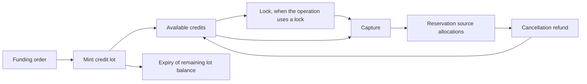
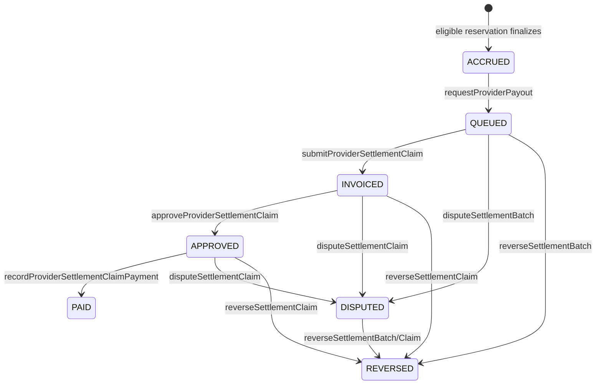

# Service credits and settlement

## Economic model

Service credits are internal accounting units. They are not native currency,
an ERC-20 token, or an externally redeemable balance held by the Diamond.
Prices, reservations and provider receivables use raw credit units.

| Constant | Value | Meaning |
| --- | ---: | --- |
| Credit decimals | `7` | Display precision for one service credit. |
| Raw units per credit | `10,000,000` | Conversion from whole credits to stored amount. |
| Accounting reference | `10` credits/EUR | Reference used for configured funding and reporting paths. |
| Default user limit | `2,000,000,000` raw units | 200 credits per institutional spending period. |
| Default spending period | `120 days` | Used when an institution has not configured another duration. |

Keep conversion at the integration boundary. A `LabBase.price` is a raw amount
per second, and the reservation price is the raw total for the booked duration.
The canonical scale is 7 decimals: `10,000,000` raw units equal one
credit, so one raw unit per second equals `0.00036` credits per hour. UIs and
services must use the shared conversion helpers instead of hard-coded scale
constants.

### Scale migration

The seven-decimal scale is a representation change at the raw-unit boundary.
Existing SQL credit amounts are human-readable credits and only need the
`DECIMAL(24,7)` precision migration; they must not be multiplied by 100. Existing
on-chain balances do need an explicit administrative adjustment by a factor of
100 when their old five-decimal raw value is being preserved. Existing lab prices
must be recalculated from the intended human price using nearest-integer
per-second conversion; expired reservations are not rewritten by this migration.

## Credit lifecycle and provenance

Each mint creates a `CreditLot` with a funding-order reference, EUR gross basis,
issue time, optional expiry and remaining amount. Consumption is FIFO across
available, non-expired lots. Every ledger movement records its kind, amount,
resulting available/locked balances, reference and timestamp.

| Movement | Accounting effect |
| --- | --- |
| `MINT` | Creates a traceable funding lot and available balance. |
| `LOCK` / `RELEASE` | Moves value into or out of the locked balance without consuming a lot. |
| `CAPTURE` | Consumes locked value from lots in FIFO order. |
| `CANCEL` | Refunds a previously allocated reservation amount. |
| `EXPIRE` | Removes a lot's remaining balance. |
| `ADJUST` | Records a referenced administrative correction. |

`ServiceCreditFacet` exposes the administrative ledger API and protects writes
with the default-admin role. Institutional booking uses the treasury path from
the reservation facets; clients should not substitute an arbitrary ledger call
for reservation confirmation.

The ledger bounds new state growth to 128 physical lots per account. Before an
append at that bound, spent/zero lots are removed and compatible lots are
merged when their funding order, expiry and remaining EUR-per-credit basis
match. A lot with a refundable allocation is retained as a logical source lot,
including after its remaining balance reaches zero, so compaction cannot destroy
refund provenance. `compactCreditLots(account)` is available for explicit
maintenance of legacy accounts. A reservation can create at most 4 source
allocations. This measured bound keeps the complete terminal
refund/finalization path below the production contract gas limit with headroom
for the surrounding reservation transition. The account ledger may still
contain 128 physical lots, and legacy reservations with larger allocation
lists remain recoverable through `cancelCreditsBatch`, which processes at most
32 allocations per transaction and returns a cursor for the next call.

## Reservation allocations and refunds

When a reservation consumes credits, the contract persists a
`CreditReservationAllocation` for every source lot, including its stable
`lotId`. It retains the funding order, amount, proportional EUR basis, expiry
and the separately tracked refund amounts. A refund restores the exact source
lot and its remaining EUR basis, so integer proration does not require an exact
EUR-per-credit ratio and cannot allocate a new physical lot at the limit. This
lets reconciliation connect a reservation charge or refund to its original
funding provenance.

Use `getCreditReservationAllocations(account, reservationRef, offset, limit)`
for that evidence. Credit lots, movements and allocations are paginated and the
public facet caps each response at 50 records. Refunds cannot exceed the
recorded allocations and keep the original expiry context, so a cancellation
cannot create perpetual credits from an expiring lot.

When a reservation reaches a terminal economic outcome, its allocation refund
entitlement is finalized exactly once. The finalizer runs after any applicable
refund, marks any retained allocation remainder as non-refundable, and releases
the source-lot reference while preserving the allocation and lot provenance for
audit. Repeated finalization is a no-op, and later refunds for that reservation
generation are rejected. The reservation settlement and treasury cancellation
paths invoke it automatically; `finalizeReservationCreditAllocations` is also
available to the default admin for reconciling legacy terminal reservations.

## Institutional spending and cancellation

Reservation confirmation checks the payer institution's available balance and
the PUC-scoped spending allowance. The successful charge records the spending
period used by that reservation, allowing a later refund to reconcile the same
period correctly.

### Reservation economics at a glance

| Reservation outcome | Charge or amount retained | Platform | Provider | Credit returned to payer |
| --- | --- | --- | --- | --- |
| Paid lab booking completed with valid `SessionStarted` evidence | Lab price | 40% by default (implicit); a per-lab override may change the rate | 60% by default; the share is cached at confirmation | None after completed use |
| Internal own-lab booking | 0 lab price + fixed 4-credit booking fee | 4 credits | None | The fixed fee is not refundable |
| Free booking at a different institution's lab | 0 lab price + fixed 2-credit booking fee | 2 credits | None | The fixed fee is not refundable |
| Eligible payer cancellation of a physical-lab booking before its start | 10% of lab price retained | 4% of lab price | 6% of lab price | 90% of lab price; any fixed booking fee remains charged |
| Physical-lab no-show without `SessionStarted` after the one-day attestation grace period | 25% of lab price retained | 10% of lab price | 15% of lab price | 75% of lab price; any fixed booking fee remains charged |
| Eligible simulation cancellation | No fee | None | None | 100% of lab price; any fixed booking fee remains charged |
| Simulation no-show without `SessionStarted` after the one-day attestation grace period | No fee | None | None | 100% of lab price; any fixed booking fee remains charged |
| Provider-initiated cancellation | No cancellation fee | None | None | 100% of lab price; any fixed booking fee remains charged |
| Pending request expires or is denied before confirmation | No credits captured | None | None | No return is needed |

The default paid-booking split is 40% platform commission and 60% provider
share. The default admin can set a per-lab override from 0% to 100% with
`setLabReservationCommission(labId, commissionBps)`; `4,000` basis points means
40%. The effective rate is cached when the reservation is confirmed. Approved
commercial agreements may set a lower platform rate for particular labs, for
example due to high equipment value or operating cost, size, capacity or
specialized maintenance. Cancellation and no-show percentages in the table are
fixed policy rates and are not changed by per-lab commission overrides.

Fixed booking fees are separate from the lab price, use institutional spending
accounting, are non-refundable and do not create a provider receivable. Credit
returns are accounting adjustments to the institution, not cash refunds; source
credit expiry may affect whether returned value can still be spent. Demo access
does not create a reservation and incurs no booking fee.

The default admin can set a per-lab override from 0% to 100% with
`setLabReservationCommission(labId, commissionBps)`; the value uses basis
points (`4,000` = 40%). `getLabReservationCommission` returns the effective rate
and whether it is overridden, and `clearLabReservationCommission` restores the
40% default. The rate is cached when the reservation is confirmed, so later
configuration changes apply only to future confirmations. Overrides have no
automatic expiry; the admin must clear them when an agreement ends.

Specific labs may negotiate a lower platform commission when their commercial
profile warrants it, for example because the equipment has a high acquisition
or operating cost, substantial size or capacity, or specialized maintenance
needs. These factors are grounds for an individual commercial agreement; the
contract does not assess them or apply a discount automatically. After an
agreement is approved, a default admin records its rate for that lab. Lowering
the platform rate increases the provider share by the same amount.

Fixed booking charges use normal institutional spending accounting and are
separate from the reservation-price settlement. Existing cancellation and
no-show paths do not reverse them. A provider-initiated cancellation refunds
the full lab price and does not accrue a provider cancellation fee. It does,
however, affect lab reputation: a
cancellation with at least 24 hours' notice applies -1, one with less than 24
hours' notice applies -2, and an explicit provider service-failure report
applies -3.

The service-failure path is only available while the reservation is still
active and its one-day `SessionStarted` attestation grace period remains open.
It requires that no `SessionStarted` evidence exists, so a payer no-show is not
automatically attributed to the provider. A technical denial of a pending
request does not carry this penalty.

Always call `previewInstitutionalBookingCancellation` before presenting a
confirmation screen. It returns the actual current fee, refund, spending-period
data and source expiry, rather than an off-chain estimate. The preview is a
bounded summary and intentionally returns an empty `allocations` array; query
the provenance with `getCreditReservationAllocations` in pages (use
`offset=0, limit=0` when only the allocation count is needed).
The earliest source-lot expiry is advisory for the confirmation UI and is not
itself a cancellation authorization condition. A cancellation can therefore
remain contract-eligible while some or all of its returned credits are already
expired; use the allocation records when an exact refund-spendability breakdown
is required.

## Provider receivable and claim lifecycle

Provider revenue is a receivable, not a token payout. On successful finalization
with SessionStarted evidence, the reservation's cached provider share is added
to the lab's accrued receivable. `requestProviderPayout` processes a bounded
batch of eligible records and moves the entire accrued bucket into the
settlement queue. This also queues receivables that a previous permissionless
release, cap cleanup or reconciliation already accrued after removing the
reservation from the payout heap. An access-authorized reservation still inside
the attestation grace remains available for late `SessionStarted` evidence, but
bounded payout-heap scans do not let it block later settleable reservations.

All reservation finalization routes use the same economic transition: the
permissionless release, the per-user cap cleanup and provider payout share the
attestation deadline, refund/receivable decision, reputation update, counter
decrement and index/heap cleanup. An `ACCESS_AUTHORIZED` reservation without
`SessionStarted` is not refunded before the one-day grace period expires.

For a physical lab without `SessionStarted` after that deadline, the no-show
outcome in the table applies. A simulation without evidence is refunded in full.

The receivable read exposes `ACCRUED`, `QUEUED`, `INVOICED`, `APPROVED`, `PAID`,
`REVERSED` and `DISPUTED` buckets. Each `ACCRUED -> QUEUED` transition creates
an immutable settlement batch. The batch ID commits to the lab, amount and a
non-zero `scopeRoot`. That root is an on-chain hash chain of the validated
accrual leaves `(labId, reservationId, amount)` in accrual order; the
corresponding `ProviderReceivableAccrued` events make the scope reconstructible.
Direct transitions out of `ACCRUED` are rejected so the aggregate amount and
scope cannot diverge.

A settlement claim has a unique non-zero `claimId`, a lab, the exact remaining
amount of one queued batch, the batch ID and an invoice-reference hash.
Submitting it atomically consumes that batch and moves the amount from
`QUEUED` to `INVOICED`. The batch ID is retained by
`getProviderSettlementClaim`; the scope root is available from
`getProviderSettlementBatch` and repeated by the
`ProviderSettlementScopeReferenced` event on each claim transition. Invoice
references are unique at the contract boundary, so SQL uniqueness cannot
create a second claim with the same financial identity.
Approval requires a non-zero, previously unused external reference. Payment
requires a non-zero, previously unused payment reference plus an attestation
hash, then moves the claim from `APPROVED` to `PAID`.

Disputing or reversing a settlement batch or claim is object-bound and
terminal for the affected object: it clears the batch remainder, moves the
exact amount between aggregate buckets, records the resolution reference,
actor and timestamp, and prevents later submit, approve or pay operations.
Any dispute resolution must be an explicit, separately audited transition.

Use `getLabProviderReceivableLifecycle` for aggregate amounts and
`getProviderSettlementClaim` for the audit record. Claim submission remains
available to the current provider/authorized backend, a configured settlement
operator or the default admin as defined by the facet. Approval requires
`SETTLEMENT_APPROVER_ROLE`; payment requires `SETTLEMENT_PAYER_ROLE` and
rejects the address recorded in `approvedBy` for the same claim. Default admin
and `SETTLEMENT_OPERATOR_ROLE` do not bypass these maker/checker guards.
Configure the approval and payment roles on different EVM accounts; the
contract enforces the distinct actor rule per claim even if role administration
accidentally overlaps them.
The generic `transitionProviderReceivableState` selector is fail-closed for
settlement invalidation: it cannot move any bucket to `DISPUTED` or `REVERSED`.
Object-bound dispute and reversal must use the four settlement batch/claim
selectors, which update the object, aggregate bucket and resolution audit
fields atomically. Accrued value must first pass through
`requestProviderPayout`, which creates its canonical batch.

For production payout previews, use `getLabProviderReceivablePaginated` as the
only supported route. Request at most 1,000 heap entries per call, starting at
`offset=0`, then continue with `nextOffset` while `hasMore` is true. Sum the
three preview categories across pages; `accruedReceivableChunk` is populated
only on the first page. The grace count is not included in the payout amount;
the three monetary values are the actionable preview.

The former unpaginated `getLabProviderReceivable(uint256)` selector is not part
of the current contract surface. Consumers must use selector `0x9441acce`
(`getLabProviderReceivablePaginated(uint256,uint256,uint256)`). The upgrade cut
must remove the former selector so no public read can trigger an unbounded
historical heap scan.
